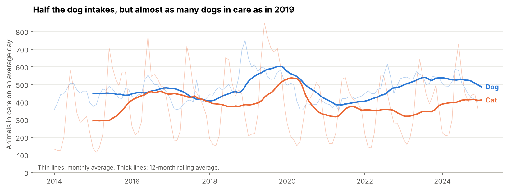
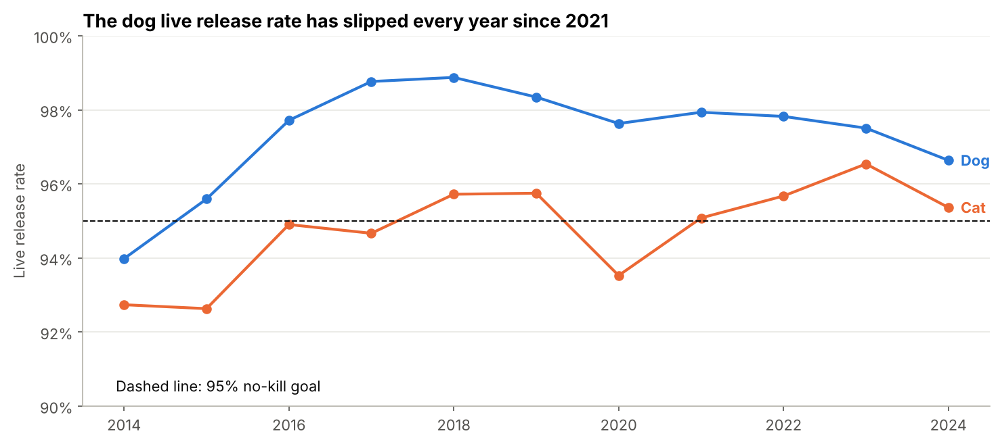
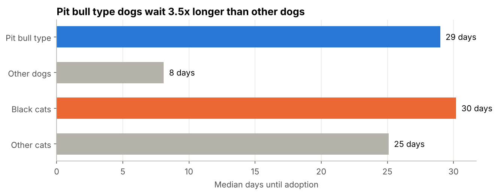

# Austin Animal Center: End-to-End Shelter Analytics

An end-to-end analytics project on 11 years of real data from the Austin Animal Center, the largest no-kill shelter in the US. I took two raw city files, cleaned them and linked them into one row per shelter stay with Python, modeled them into a star schema with SQL (including automated data quality checks), analyzed them in Jupyter, and built a Power BI dashboard on top.

**The question:** Austin's dog intakes have halved since 2020. Is the shelter actually under less pressure?

**Short answer: no.** Dogs now stay about twice as long, so the shelter holds almost as many dogs on an average day as it did in 2019, and the live release rate for dogs has slipped every year since 2021.

## Dashboard

Power BI dashboard in progress.

## Pipeline

```
data/raw/ (2 city CSVs: 174k intakes, 174k outcomes)
   │  src/clean.py        clean types, parse ages, split fields, link each intake to its outcome
   ▼
data/processed/stays.parquet (one row per stay)
   │  src/build_model.py  runs sql/01 (star schema), sql/02 (quality checks), exports CSVs
   ▼
data/processed/powerbi/ (fact_stay, fact_daily_census, dim_animal, dim_intake_type, dim_outcome_type, dim_date)
   │
   ▼
Power BI dashboard  +  notebooks/02_analysis.ipynb
```

### The hard part: linking intakes to outcomes
The city publishes intakes and outcomes as separate files with no stay ID. 156,000 animals account for 174,000 intakes, so many animals came back more than once, and a plain join on animal ID would multiply rows. I matched each intake to the first outcome for that animal after it, only if it happened before the animal's next intake (`pd.merge_asof`). 99.1% of stays matched. Most of the rest are animals still in care when the data was exported.

### Other cleaning
- Two timestamp formats mixed in one column
- Ages stored as text ("2 years", "3 weeks", "-1 years") converted to days and grouped
- Sex and spay/neuter status split into two fields
- 3,000+ breed strings reduced to a primary breed, a mix flag and a breed group
- Exact duplicate rows removed

### Data quality checks
`sql/02_data_quality_checks.sql` runs on every build and stops the export if any check fails: unique stay IDs, every stay linked to an animal and a date, no outcome before its intake, no outcome after the animal's next intake, no gaps in stay numbers, no negative census.

### Star schema

| Table | Grain | Rows |
|---|---|---|
| `fact_stay` | one shelter stay | 173,776 |
| `fact_daily_census` | one day × animal type | 21,175 |
| `dim_animal` | one animal | 156,287 |
| `dim_intake_type` | intake type + condition | 76 |
| `dim_outcome_type` | outcome type + subtype | 48 |
| `dim_date` | one calendar day | 4,261 |

KPI definitions: [`dashboard/kpi_definitions.md`](dashboard/kpi_definitions.md) · DAX: [`dashboard/measures.dax`](dashboard/measures.dax)

## Key findings (dogs and cats, 2014 to 2024)

**1. Fewer dogs come in, but they stay much longer.** Dog intakes dropped from about 10,000 a year to about 5,100. The median dog stay went from 5 days (2019) to 14 days (2023).



**2. The dog live release rate is slipping.** It's still above the 95% no-kill goal, but has fallen from 98.9% (2018) to 96.6% (2024).



**3. Some animals wait much longer for a home.** Pit bull type dogs wait a median 29 days to be adopted, compared with 8 for other dogs. Senior dogs wait 21 days, compared with 6 for puppies. Black cats wait about 5 days longer than other cats, while black dogs don't wait longer at all (Mann-Whitney tests).



**4. Kitten season is predictable.** Cat intakes more than triple from February to May.

**5. Adoptions that fail usually fail fast.** About 1 in 10 adoptions comes back within six months, and half of all returns happen in the first 30 days.

## Recommendations
1. **Report animals in care next to intakes.** Intakes alone made 2023 look like a quiet year when it wasn't.
2. **Focus adoption promotion on pit bull type and senior dogs.** They hold kennels 3 to 4 times longer than other dogs.
3. **Recruit kitten fosters in February,** before the spring surge.
4. **Check in with adopters in the first 30 days,** when half of all returns happen.

## Limitations
- Breed and color are visual labels given at intake and can be inconsistent.
- Differences in wait time are associations, not causes (age, size and health overlap with breed).
- Returns only count animals brought back to this shelter.
- 2013 and 2025 are partial years and are left out of yearly trends.

## Repo layout
```
data/raw/              original city exports (gzipped)
data/processed/        cleaned stays + Power BI tables (built by the scripts)
src/clean.py           cleaning and intake-outcome linking
src/build_model.py     runs the SQL, quality checks and exports
sql/                   star schema, data quality checks, KPI query
notebooks/             01 profiling + cleaning + linking, 02 analysis
dashboard/             DAX measures, KPI definitions, theme
images/                charts used in this README
```

## Run it
```bash
pip install -r requirements.txt
python src/clean.py
python src/build_model.py
```
Then open the notebooks.

**Tools:** Python (pandas, NumPy, SciPy, Matplotlib), SQL (DuckDB), Power BI (DAX, star schema), Jupyter

**Data:** City of Austin Open Data Portal, [Austin Animal Center Intakes](https://data.austintexas.gov/d/wter-evkm) and [Outcomes](https://data.austintexas.gov/d/9t4d-g238), October 2013 to May 2025.
